  

  

  
  
  

 

  

 

<h2 align="center">⚡ Stack tecnológico</h2>

   
  

<table align="center">
  <tr>
    <td align="center" width="200"><b>🧠 Backend</b></td>
    <td align="center" width="200"><b>🎨 Frontend</b></td>
    <td align="center" width="200"><b>⚙️ Automatización</b></td>
  </tr>
  <tr>
    <td align="center">Java · Spring Boot Python · APIs REST</td>
    <td align="center">JavaScript HTML5 · CSS3</td>
    <td align="center">n8n · Workflows Integraciones</td>
  </tr>
</table>

 

<h2 align="center">🚀 Proyectos destacados</h2>

  
  
  
  
  
  

 

<h2 align="center">📊 Métricas en GitHub</h2>

  
  

  

  

 

<h2 align="center">🐍 Mis contribuciones</h2>

  <picture>
    <source media="(prefers-color-scheme: dark)" srcset="https://raw.githubusercontent.com/shirlyk89/shirlyk89/output/github-snake-dark.svg" />
    <source media="(prefers-color-scheme: light)" srcset="https://raw.githubusercontent.com/shirlyk89/shirlyk89/output/github-snake.svg" />
    
  </picture>

 

<h2 align="center">🤝 Conectemos</h2>

  
  <!-- Reemplaza TU_USUARIO por tu usuario de LinkedIn -->
  
  <!-- Reemplaza TU_CORREO por tu correo -->
  

  

